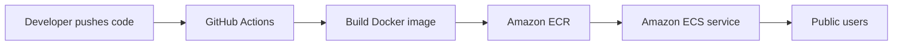

# Crypto Tracker: Dockerized app with CI/CD on AWS

A live cryptocurrency price tracker (Bitcoin, Ethereum, Solana) packaged in Docker and deployed on AWS ECS. Every push to `main` automatically builds and deploys the app.

## Architecture



## Tech Stack
- **App:** HTML, CSS, JavaScript (CoinGecko API)
- **Container:** Docker, Nginx
- **Registry:** Amazon ECR
- **Deployment:** Amazon ECS
- **CI/CD:** GitHub Actions
- **Region:** ap-south-1 (Mumbai)

## How it works
1. Code is pushed to the `main` branch.
2. GitHub Actions builds the Docker image.
3. The image is pushed to Amazon ECR (tagged `latest` and with the commit SHA).
4. The pipeline forces a new ECS deployment, which pulls the latest image.

## Run locally
```
docker build -t crypto-tracker .
docker run -p 8080:80 crypto-tracker
```
Open http://localhost:8080

## Setup notes
- Add `AWS_ACCESS_KEY_ID` and `AWS_SECRET_ACCESS_KEY` as GitHub repository secrets.
- The IAM user needs ECR push and ECS update permissions.
- The Security Group must allow inbound HTTP (port 80).

## What I learned
- How images move from build to registry to a running service
- How ECS task definitions and services work
- Debugging a timeout caused by a missing Security Group rule
- Automating deployment with GitHub Actions

## Future improvements
- Add an Application Load Balancer for a stable URL
- Provision the infrastructure with Terraform
- Switch from IAM access keys to GitHub OIDC

## Author
Narayan Kushwaha
LinkedIn: www.linkedin.com/in/narayan-kushwaha-132a82273
